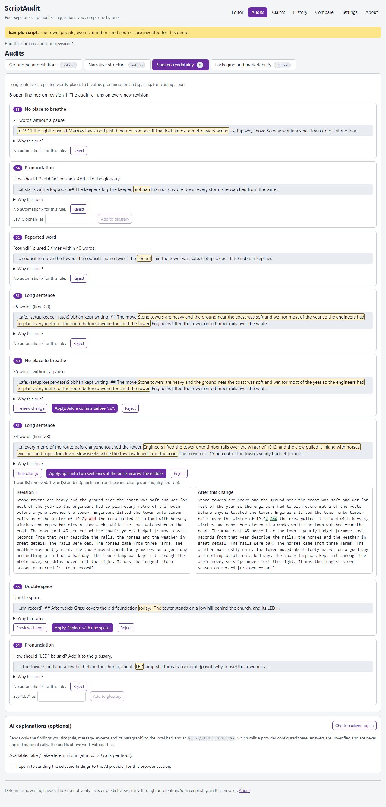

# ScriptAudit

An editorial review workbench for video and podcast scripts. Paste or import a draft, run **four
separate, deterministic audits** (grounding, narrative structure, spoken readability, packaging),
read why each finding was raised, and **accept or reject suggestions one at a time** with a
side-by-side diff. Every change is a new revision, so undo and revert are exact and the original
is always recoverable.



> **Status:** v0.1, built and tested locally. It is **not published or deployed**; run it locally
> (below). ScriptAudit does **not** verify facts and does **not** predict views, click-through or
> retention. Its checks are transparent writing rules.

## What it does

- **Editor**: paste text, import a Markdown or text file (a first `# Title` line becomes the title),
  or open a saved workspace. Sections (`## Heading`) and beats (paragraphs) are mapped in an
  outline with word counts and a spoken-duration estimate at an adjustable narration speed
  (100 to 220 words per minute). Saving creates a revision.
- **Grounding**: sentences with numbers, superlatives or attribution phrases count as assertions.
  An assertion is covered only when it carries a claim tag `[c:id]` that points to a claim you
  documented with a citation and a quote, **and** the claim contains the sentence's numbers,
  superlatives and quantity words. A tag covers only its own sentence. The app never creates claims
  or sources.
- **Narrative**: repeated phrases and sentence openings, `{setup:key}` without a matching
  `{payoff:key}` (and the reverse), long stretches of exposition, and abrupt section transitions.
- **Spoken readability**: long sentences (adjustable limit, with a split suggestion), repeated words,
  long runs without a pause (with a comma suggestion), pronunciation of acronyms and unusual words
  against a glossary you keep, and double spaces.
- **Packaging**: title and hook alignment, sensational phrasing (with neutral alternatives), title
  numbers or superlatives not backed by a covered sentence, and title length. These are writing
  suggestions, not statements about any platform.
- **Decisions**: every finding has Preview change (side-by-side diff), Apply and Reject. Rejections
  are kept and can be restored. Suggestions never apply themselves, a stale suggestion is refused,
  and an **approved** script is locked until you reopen it.
- **History and compare**: undo, revert to any revision, download any revision, and compare any two
  revisions side by side.
- **Exports**: the current revision as Markdown, a narration text (tags and markup removed, glossary
  appended), an audit report, and the full workspace as JSON.
- **Optional AI explanations** through a small local FastAPI backend: off by default, opt-in per
  browser session, only the findings you tick are sent, the provider's answer must match a strict
  schema, and rewrites that add a number, superlative, attribution, quotation, link or citation are
  discarded. AI rewrites are
  ordinary suggestions you can preview, apply or ignore.

## Quick start

Needs Node.js 20.19 or newer; Python 3.11 or newer for the optional backend and the full gate.

```powershell
npm ci
npm run dev        # http://localhost:5177/script-audit/
```

The invented sample script ("Load the sample script") and [examples/draft.md](examples/draft.md)
show every audit.

Optional backend and full verification:

```powershell
python -m venv .venv
.venv\Scripts\python -m pip install -r backend\requirements.lock.txt
cd backend; ..\.venv\Scripts\python -m script_audit     # http://127.0.0.1:8799, API docs at /api/docs
npm run verify     # format, lint, types, unit tests, backend lint/format/types/tests, build, secret scan, e2e
```

`scripts\verify.ps1` and `scripts/verify.sh` run the same steps and stop on the first failure. The AI
provider is configured only through the backend's environment (see [.env.example](.env.example)).

## Honest limits

The audits are rules on text, so they miss things and flag things a writer may want to keep; every
finding can be rejected. Grounding checks links, not truth. Duration is an estimate. English only.
See [docs/known-limitations.md](docs/known-limitations.md).

## Documentation

[docs/spec](docs/spec), [docs/architecture.md](docs/architecture.md), [docs/demo.md](docs/demo.md),
[docs/test-report.md](docs/test-report.md), [docs/handoff.md](docs/handoff.md),
[docs/backlog.md](docs/backlog.md), [SECURITY.md](SECURITY.md), [CONTRIBUTING.md](CONTRIBUTING.md),
[AI_ASSISTANCE.md](AI_ASSISTANCE.md).

## License

MIT, see [LICENSE](LICENSE). The sample script and example draft are invented.
